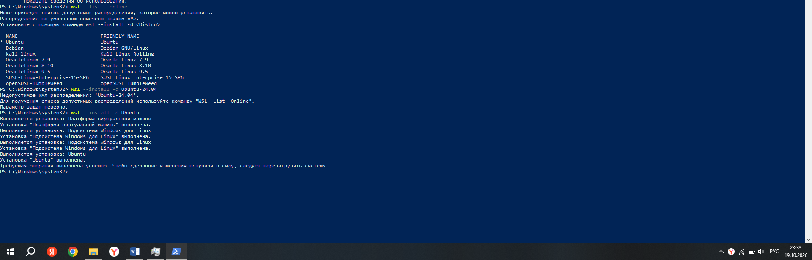
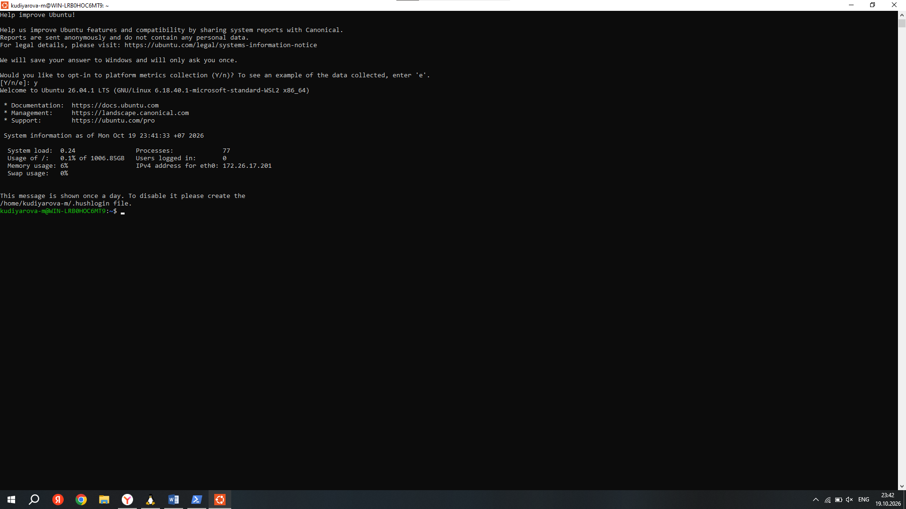
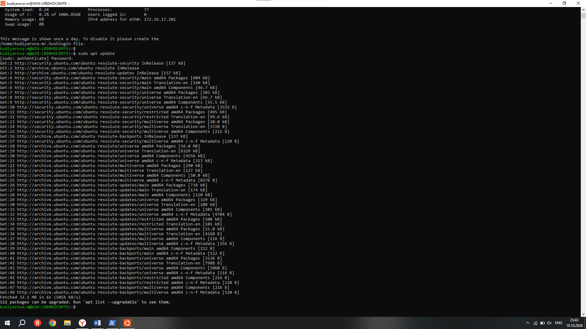
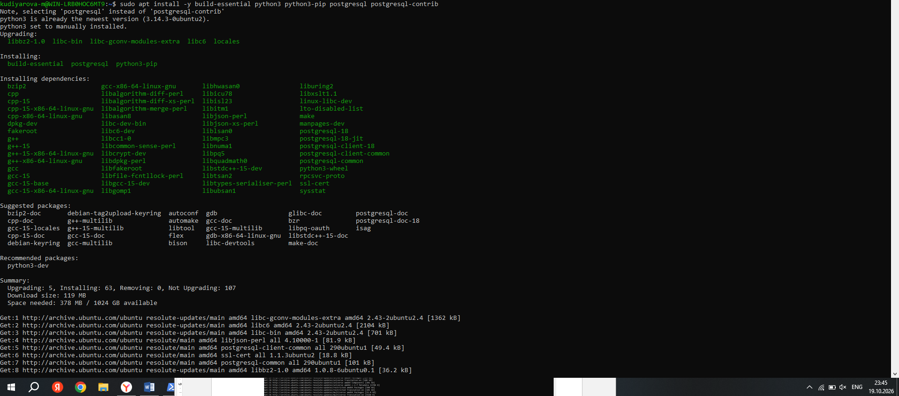
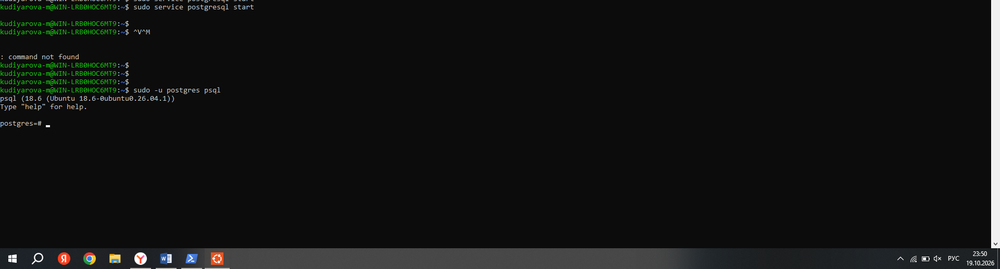
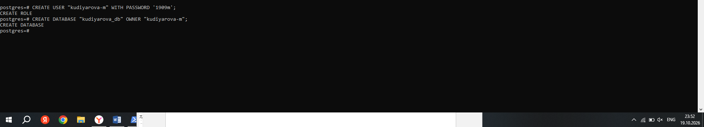
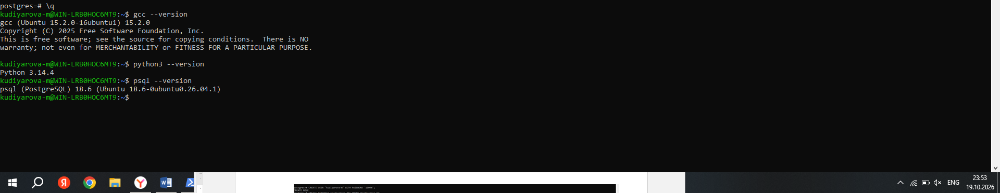

# Отчёт по развертыванию окружения WSL

**Студент:** Кудиярова Мария
**Дата:** 19.10.2026

## 1. Проверка виртуализации
Перед установкой была проведена проверка поддержки виртуализации в системе (Диспетчер задач -> Производительность -> ЦП). Виртуализация включена.


## 2. Установка WSL и дистрибутива Ubuntu
Установка производилась через Windows PowerShell, запущенный от имени администратора. Сначала был проверен список доступных дистрибутивов, затем выполнена установка Ubuntu.

```powershell
wsl --list --online
wsl --install -d Ubuntu
```



## 3. Запуск Ubuntu и создание пользователя
После перезагрузки системы приложение Ubuntu было найдено через поиск и запущено.


При первом запуске системы был создан пользователь `kudiyarova-m`, соответствующий требованиям задания.


Успешный вход в систему под учетной записью `kudiyarova-m`.



## 4. Обновление пакетов
Перед установкой необходимого ПО было выполнено обновление списков пакетов.

```bash
sudo apt update
```



## 5. Установка SDK, компилятора и СУБД
Установлены компилятор GCC (пакет `build-essential`), интерпретатор Python 3 и СУБД PostgreSQL.

```bash
sudo apt install -y build-essential python3 python3-pip postgresql postgresql-contrib
```



## 6. Настройка PostgreSQL
Был выполнен запуск сервиса PostgreSQL и вход в консоль под системным пользователем `postgres`.

```bash
sudo service postgresql start
sudo -u postgres psql
```



В консоли PostgreSQL создан новый пользователь (роль) и база данных.

```sql
CREATE USER "kudiyarova-m" WITH PASSWORD '1909m';
CREATE DATABASE "kudiyarova_db" OWNER "kudiyarova-m";
```



## 7. Проверка версий установленного ПО
Финальная проверка версий компилятора, интерпретатора и СУБД.

```bash
gcc --version
python3 --version
psql --version
```


